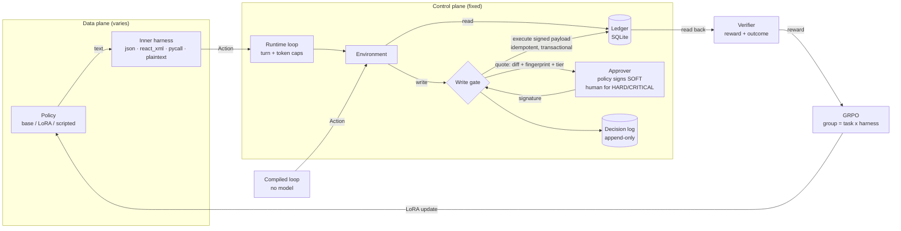

# Architecture

## Modules

| Path | Responsibility |
|---|---|
| `domain/ledger.py` | SQLite system of record, integrity constraints, append-only log (triggers) |
| `domain/tasks.py` | Deterministic task suite: 7 kinds, canonical/paraphrase/novel phrasings, train/test splits |
| `tools/registry.py` | Tool declarations with permissions and strict argument coercion |
| `tools/gate.py` | Quote → sign → execute-only-what-was-signed; idempotency; fail closed |
| `env.py` | One episode's world; routes reads, writes and control actions; records facts |
| `rewards.py` | Whole-ledger read-back, closed outcome taxonomy, efficiency bonus |
| `harnesses/` | Four inner harnesses (format only) |
| `runtime.py` | The single agent loop; `LoopConfig` makes "loop engineering" a config |
| `baselines.py` | Compiled loop and router |
| `policies/` | `ScriptedPolicy` (CPU, deterministic) and `HFPolicy` (transformers + LoRA) |
| `training/` | Advantages (pure Python) and the GRPO loop |
| `eval/` | Runner, statistics, error analysis + ratchet, report, charts, static site |

## Data flow of one write

1. The model emits text; the inner harness parses it into an `Action`, or a `ParseError`
   is rendered back to the model.
2. The runtime counts the turn against its caps and passes the action to the environment.
3. For a write tool, the gate validates the arguments, evaluates the policy, and produces
   a **quote**: the exact diff, a SHA-256 fingerprint of the canonical payload, and a tier.
4. The approver signs SOFT quotes. HARD and CRITICAL quotes need a human, so the write
   fails closed and the agent should have escalated instead.
5. The executor re-fingerprints the payload, checks it against the signature, checks the
   idempotency key, applies the change in a transaction and records it.
6. Every decision, executed or not, is appended to the decision log.
7. At the end, the verifier reads the whole ledger back and assigns an outcome and a
   reward.

## Why the same gate for every system
The compiled loop, the base model, the loop-engineered model, the RL adapter and the
router are all measured against the same control plane, so the comparison is about
*behaviour inside fixed bounds*, never about which system was trusted more.
